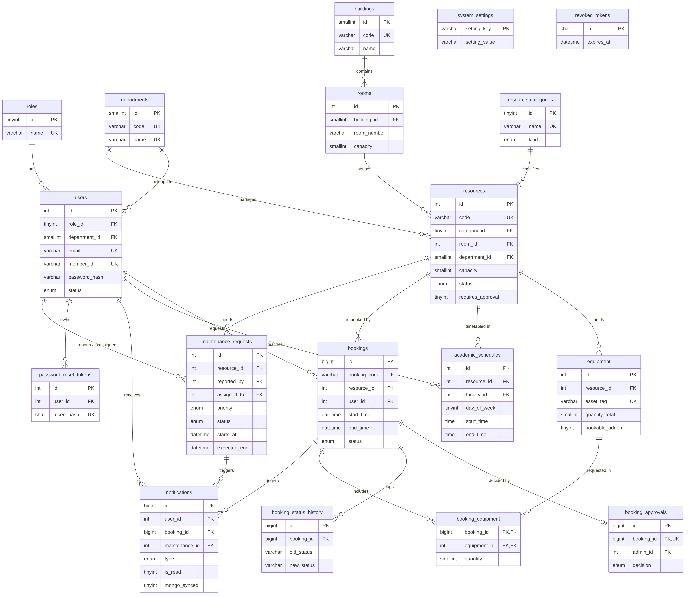

# ER Diagram

Files: `database/diagrams/er_diagram.png`, `er_diagram.svg` and the editable source `er_diagram.mmd` (Mermaid). Re-render with `mmdc -i er_diagram.mmd -o er_diagram.png`.

## Relationships

| Parent | Child | Cardinality | Meaning |
|---|---|---|---|
| roles | users | 1 : N | each user has exactly one role |
| departments | users, resources | 1 : N | optional link (SET NULL on delete) |
| buildings | rooms | 1 : N | a building has many rooms |
| rooms | resources | 1 : N | a room can house more than one bookable resource |
| resource_categories | resources | 1 : N | lab, classroom, hall, equipment kit |
| resources | equipment | 1 : N | assets kept in a resource (cascade delete) |
| resources | academic_schedules | 1 : N | recurring timetable classes that block ad-hoc bookings |
| resources | bookings | 1 : N | the table the double-booking guard protects |
| users | bookings | 1 : N | requester |
| bookings | booking_approvals | 1 : 0..1 | one decision per booking (UNIQUE booking_id) |
| bookings | booking_status_history | 1 : N | every status change (written by triggers) |
| bookings and equipment | booking_equipment | M : N | junction table with quantity, composite PK |
| resources | maintenance_requests | 1 : N | blocks bookings in its window |
| users | maintenance_requests | 1 : N twice | `reported_by` and `assigned_to` |
| users | notifications | 1 : N | created by triggers |
| bookings, maintenance_requests | notifications | 1 : N | optional back-links (SET NULL) |
| users | password_reset_tokens | 1 : N | SHA-256 hash only |

`system_settings` (key/value) and `revoked_tokens` (logout blacklist by JWT id) stand alone.

## MongoDB collections (secondary database)

| Collection | Purpose | Key fields |
|---|---|---|
| `activity_logs` | who did what: logins, failed logins, CRUD, exports | userId, action, category, success, ip, createdAt |
| `booking_audit` | booking lifecycle and blocked conflicts | bookingId, event (created, approved, conflict_blocked, auto_cancelled...), actor, snapshot |
| `notification_history` | archive of notifications copied from MySQL | notificationId (unique), userId, type, title, message |
